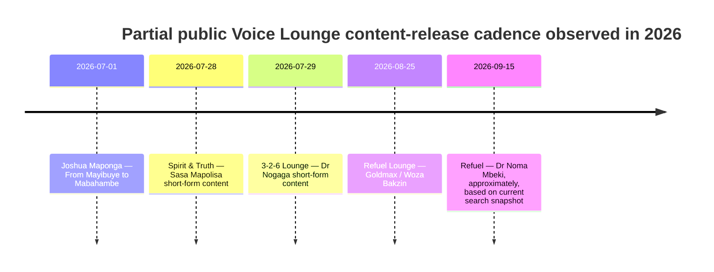

# The Voice Lounge: Comprehensive Public Profile and Website Upgrade Research

## Executive summary

**Research date:** 20 September 2026  
**Market:** South Africa, with emphasis on East London / Buffalo City and the Eastern Cape  
**Prepared for:** Interlink Global Technologies  
**Scope:** Public-source research only; no backend implementation has been performed.

The most important finding is that **The Voice Lounge should no longer be modelled on the new website as merely a podcast**. Public evidence shows that it began as a podcast concept but has developed into a broader Eastern Cape multimedia business combining **online radio, video podcasts/interviews, a recording studio, news/editorial coverage, a record label, mobile applications and commercial advertising products**. Its official site describes the operation as a three-platform media hub, while South African press reporting says the online-radio operation went live on **1 August 2025** and that the brand subsequently expanded rapidly. citeturn24search15turn27view0turn24search33

The existing official public brand domain is **[https://www.thevoicelounge.co.za/](https://www.thevoicelounge.co.za/)**. Its principal content surfaces are `/podcasts`, `/shows` and `/live`. The current podcast catalogue exposes **27 on-demand cards**, but it does **not expose dates, durations, RSS enclosure information or a definitive total-episode counter**, so 27 should be treated as the number presently visible on the website rather than a verified lifetime episode total. citeturn26view0

Public distribution is unusually **video/social/app-centric rather than conventional RSS-podcast-centric**. The Voice Lounge has an identifiable official YouTube channel, Facebook page and X account, plus native Android and iOS applications. The official About page says its podcast segments are published across streaming directories, but this research did **not locate a confirmed public RSS feed or a verifiable The Voice Lounge show listing/ID on Apple Podcasts, Spotify Podcasts or Podbean**. Those fields therefore remain **unspecified**. citeturn24search15

The strongest publicly visible audience signal is Facebook. Search snapshots on 20 September 2026 showed approximately **214,100 followers and 14,007 people “talking about this”**. Earlier Daily Dispatch reporting, based on comments from The Voice Lounge management, recorded **67,000 subscribers and 18.8 million views by November 2025** and later reported management's claim of about **22 million Facebook views** by March–April 2026. These are different metrics and periods and should **not be summed**, but collectively they indicate substantial social reach for a relatively young media operation. citeturn24search8turn27view0turn25search29

The iOS app provides an additional independent public signal: Apple's South African storefront showed **4.5/5 from six ratings and a No. 2 Entertainment chart position** when crawled, while Google Play showed **1K+ downloads**. Apple describes the app as English-language and currently says the developer has not declared supported accessibility features. citeturn20view0turn20view1

Commercialisation is already materially developed. The website offers a **seven-day premium trial followed by R9.99/month**, with premium access to streams and exclusive podcasts. Its advertising proposition explicitly sells integrated campaigns across digital radio, video podcasts and editorial articles, as well as host-read endorsements, sponsored podcast seasons, banners and in-house audio advertising production. The advertiser page says campaign reporting can include unique listeners, streaming hours, podcast downloads and page views, although those aggregate figures are not publicly disclosed. citeturn22view0turn23view0

The brand also has meaningful South African editorial and industry validation. Daily Dispatch has profiled station manager **Thobeka Buswana**, brand head **Lungisa Sigobelwana**, artist **Sesethu Maneli** and Voice Lounge recording projects; The Herald/Arena network exposes Voice Lounge multimedia entries. This coverage supports positioning The Voice Lounge as an emerging regional media organisation rather than simply a show archive. citeturn27view0turn24search33turn25search29turn24search22

For Interlink's upgrade, the key architectural recommendation is therefore to model **The Voice Lounge as an `Organization` containing Shows/PodcastSeries, Episodes, People, Live Broadcasts, Articles, Campaigns, Artists and Media Assets**, rather than building the content hierarchy around a single generic “podcast” collection. YouTube should become an automated video-ingestion source, while editorial ordering, homepage selections, hosts, guests, campaigns and commercial metadata remain controlled through the future Supabase CMS.

Several important public-data gaps should **not be guessed**: RSS feed URL, Spotify show ID, Apple Podcasts show ID, definitive lifetime episode count, YouTube subscriber count, Instagram follower count and canonical handle, TikTok presence, official LinkedIn company page, exact brand font family, official colour hex values, trademark registrations, full production-team roster, podcast audio codec/bitrate and episode-level transcript availability are all **unspecified** at present.

## Identity and public footprint

The Voice Lounge publicly positions itself as **“The Eastern Cape's Voice, Amplified”** and describes its operation as a first-of-its-kind East London media hub combining live broadcasting, on-demand podcasts and recording facilities, with student tutoring/local-development activity also identified as a fourth organisational pillar. citeturn24search15

South African press supplies useful historical context that the current site does not. Daily Dispatch reported in November 2025 that the station had gone on air on **1 August 2025**. A March 2026 profile quoted Lungisa Sigobelwana explaining that The Voice Lounge **started as a podcast**, then expanded into online radio and a recording studio. The same reporting covers its subsequent record-label expansion. citeturn27view0turn24search33

**Core URLs**

| Function | Public URL | Research assessment |
|---|---|---|
| Brand homepage | [thevoicelounge.co.za](https://www.thevoicelounge.co.za/) | Primary public brand domain; use as the migration/canonical-domain baseline. citeturn22view0 |
| Podcast catalogue | [thevoicelounge.co.za/podcasts](https://www.thevoicelounge.co.za/podcasts) | Current on-demand catalogue; 27 cards visibly exposed. citeturn26view0 |
| Programme schedule | [thevoicelounge.co.za/shows](https://www.thevoicelounge.co.za/shows) | Current Monday–Sunday show/host schedule. citeturn28view3 |
| Live service | [thevoicelounge.co.za/live](https://www.thevoicelounge.co.za/live) | Live broadcast, interaction and premium conversion surface. citeturn19search14 |
| About | [thevoicelounge.co.za/about-us](https://www.thevoicelounge.co.za/about-us) | Organisation positioning and operating pillars. citeturn24search15 |
| Contact | [thevoicelounge.co.za/contact-us.php](https://www.thevoicelounge.co.za/contact-us.php) | Current public business/studio contact details. citeturn28view2 |
| Advertising | [thevoicelounge.co.za/advertise-here.php](https://www.thevoicelounge.co.za/advertise-here.php) | Public commercial/media-sales proposition. citeturn23view0 |
| Privacy | [thevoicelounge.co.za/privacy-policy.php](https://www.thevoicelounge.co.za/privacy-policy.php) | POPIA-facing privacy document. citeturn28view0 |
| Terms | [thevoicelounge.co.za/terms-of-service.php](https://www.thevoicelounge.co.za/terms-of-service.php) | Subscription, IP and service terms. citeturn28view1 |

A specific HTML `<link rel="canonical">` value could **not be verified from the crawler output**, so the canonical-tag implementation itself is **unspecified**. The public domain and internal linking nevertheless make `https://www.thevoicelounge.co.za/` the clear existing brand-domain authority.

There is also an important **address-consistency issue**. The current Contact page gives **4 Steward Drive, Baysville, East London, 5241**, while an older indexed live-page version exposes **12 Gloucester Road, Vincent, East London, 5247**. The CMS migration should resolve which is operationally correct and maintain exactly one authoritative location record, with old addresses removed from metadata and stale indexed pages redirected where appropriate. citeturn28view2turn24search29

**Social profiles and public counts**

| Network | Public profile / evidence | Public count as found | Assessment |
|---|---|---:|---|
| Facebook | [facebook.com/TheVoiceLoungeza](https://www.facebook.com/TheVoiceLoungeza/) | **≈214.1K followers; 14,007 talking about this** | Strongest discoverable social footprint. Search snapshots fluctuated slightly between 214,098 and 214,105 followers, so display as ≈214.1K rather than false precision. citeturn24search8turn19search17 |
| YouTube | [youtube.com/@THEVOICELOUNGE](https://www.youtube.com/@THEVOICELOUNGE) | **Unspecified** | Official channel located. Subscriber count did not surface reliably in public search results. citeturn19search20turn19search30 |
| X / Twitter | [x.com/TheVoiceLounge](https://x.com/TheVoiceLounge) | **Unspecified** | `@TheVoiceLounge`; active public commentary is indexed, including March 2026 budget coverage. citeturn24search25 |
| Instagram | Representative branded material: [Refuel Lounge reel](https://www.instagram.com/reel/DcdX98MjEyv/) | **Unspecified** | Branded Instagram publishing is confirmed, but this crawl did not establish a canonical account URL/follower count to sufficient confidence. citeturn24search18 |
| LinkedIn — company | **Unspecified / not conclusively located** | **Unspecified** | No reliably verified official company page emerged. |
| LinkedIn — brand head | [Lungisa Sigobelwana](https://za.linkedin.com/in/lungisa-sigobelwana-910346bb) | Not used as organisation metric | Public profile identifies him as a director/media strategist/entrepreneur associated with The Voice Lounge. citeturn25search5 |
| TikTok | **Unspecified** | **Unspecified** | No sufficiently verified official account was located. |
| Discord | **Unspecified** | — | No public server discovered. |
| Forum/community board | **Unspecified** | — | Engagement is instead concentrated in social/mobile interaction. |
| Newsletter | **Unspecified** | — | No clearly public newsletter sign-up was found during the review. |

The lack of a verified Instagram canonical URL, TikTok identity, LinkedIn company page and YouTube subscriber count should become a **brand-governance task**, not something the redesigned site infers automatically. A CMS-level `social_profiles` record should only be populated after the media team confirms each account.

**Contact and booking information** is comparatively clear. The current official contact page lists **043 050 6570**, **+27 83 950 7019**, **Info@thevoicelounge.co.za**, and the Baysville address above; it explicitly invites studio bookings. The site also exposes a WhatsApp support action. citeturn28view2

A separate public talent email, `talent@thevoicelounge.co.za`, has been used in station campaign material. Individual presenter booking emails or direct presenter telephone numbers are **not publicly standardised on the current official site**, so host-level contact information should be treated as unspecified unless supplied by management.

## Programming, people and episode catalogue

The present programme strategy spans news, politics, business, interviews, music, lifestyle, sports and religion/spirituality rather than functioning as a single-format podcast network. The current official schedule names recurring properties including **The Breakfast Plug, Beyond The Grey, Refuel Lounge, 3-2-6 Lounge, The VoiceLounge Sitting, The Sports Lounge, After Dark Lounge, Spirit & Truth, The Triumph Lounge, Solitude Lounge, Connect & Learn, The Weekend Gateaway, The Music Lounge, The Logos Moment, The Grace Connection, The Chapter Lounge, Rhythm & Sound Lounge and Koinonia—The Fellowship**. citeturn28view3

The currently published host line-up includes **Miss Vee & Garth Ah-Mook, Baby Obuhle Sihu, Zan, Brian, Asanda Magaqa, Tsepang, Narcho Mabizela, Sasa Mapolisa, Tsepo Nontyi, Tsepang Liphapang, Pastor Mafaya, Pastor Jaytee, Tsepo and Pastor Gugu**, plus a resident DJ slot. citeturn28view3

There are visible data-normalisation issues that the new CMS should eliminate. For example, the schedule uses **“NARCHO MABIZELA”**, whereas a podcast title says **“Nacho Mabizela”**; several current catalogue entries contain truncated words or spelling errors, and the current site exposes character-encoding corruption around em dashes in “Koinonia—The Fellowship”. citeturn26view0turn28view3

**Publicly identifiable leadership and production figures**

| Person | Public role/evidence | Public bio status | Public contact |
|---|---|---|---|
| **Lungisa Sigobelwana** | Publicly described as head/boss of The Voice Lounge; LinkedIn identifies him as Director / Media Strategist / Entrepreneur. Daily Dispatch also described him as heading recording-studio and other business operations. citeturn25search5turn27view0 | Strongest documented senior leadership profile. | No individual Voice Lounge email publicly standardised; use organisation contact. |
| **Thobeka Buswana** | Daily Dispatch reported her appointment as station manager in Nov 2025. She had more than two decades' broadcasting experience, including presenting/programme-management/acting-management work at Umhlobo Wenene FM and station management at TruFM. citeturn27view0 | Substantial published professional biography. Her current 2026 employment status should be reconfirmed before putting a permanent bio on the upgraded site. | Unspecified individually. |
| **Nqubeko Mbatha** | Publicly pictured/identified as music producer around Voice Lounge's record-label activity. An external TBN Africa bio describes 15+ years in music, prior production work with Joyous Celebration and co-ownership of Koko Records. citeturn24search33turn25search27 | Significant public industry bio, but exact contractual/current TVL title is **unspecified**. | Not listed as a Voice Lounge contact. |
| **Stephen Tamsanqa Mahanaim Motimele** | Google Play developer-account identity for the Android app. citeturn20view1 | Technical/app-store role; should not be presented as editorial production staff without confirmation. | `thevoiceloungetech@gmail.com` is publicly listed by Google Play. citeturn20view1 |
| **Sakie Magele** | Apple lists this provider/developer identity for the iOS app. citeturn20view0 | App-store provider role; editorial role unspecified. | Unspecified on core site. |

Daily Dispatch reported that the operation employed **22 people including presenters and technical staff** in November 2025. No complete public staff directory was found, so the remainder of the production, engineering, editing, camera, social and editorial team is **unspecified**. citeturn27view0

**Episode-catalogue status.** The current official `/podcasts` page exposes **27 content cards**. Because it has no visible publish date, duration or total-count metadata, it is impossible from the official catalogue alone to prove that these are all episodes ever published or that display order is strictly chronological. Accordingly, the following table uses the **first 20 cards displayed on 20 September 2026 as the best public proxy for the “recent 20”**, while explicitly preserving missing values rather than inventing them. citeturn26view0

| Date | Title | Duration | Description / subject | Guest(s) / principal voices | Link | Publicly confirmed availability |
|---|---|---|---|---|---|---|
| **Unspecified** | Lee Generes joins Nacho Mabizela for a conversation about her music journey | Unspecified | Music journey, identity, ambition, entertainment and social-media rise. | **Lee Generes**; interviewer Nacho Mabizela | [Catalogue](https://www.thevoicelounge.co.za/podcasts) | Official website |
| **Unspecified** | BEYOND THE GREY — Sivenathi Nazo \| Ward 18 Councillor Candidate | Unspecified | Local issues, community priorities and ward representation. | **Sivenathi Nazo** | [Catalogue](https://www.thevoicelounge.co.za/podcasts) | Official website |
| **Unspecified** | The Triumph — Mr Siyanda Vazi, Ubomi Foundation Founder | Unspecified | Ubomi Foundation's child/community-development work. | **Siyanda Vazi** | [Catalogue](https://www.thevoicelounge.co.za/podcasts) | Official website |
| **Unspecified** | The Breakfast Plug — National Wills Week | Unspecified | Wills, estate planning, protecting family and legacy. | **Siyambonga Jara**, Wills & Estate Planning Specialist at Capital Legacy | [Catalogue](https://www.thevoicelounge.co.za/podcasts) | Official website |
| **Unspecified** | Beyond the Grey — Sihle Peter Cwenga: Breaking Down the President's Recent Letter | Unspecified | Discussion of the President's letter and issues raised in it. | **Sihle Peter Cwenga** | [Catalogue](https://www.thevoicelounge.co.za/podcasts) | Official website |
| **Unspecified** | Khanya Makhaphela sits down with Tsepo Nontyi | Unspecified | Accounting career, professional challenges/opportunities and owning an accounting firm. | **Khanya Makhaphela**; Tsepo Nontyi | [Catalogue](https://www.thevoicelounge.co.za/podcasts) | Official website |
| **Unspecified** | BEYOND THE GREY | Unspecified | Youth development, community-building and constructive recreational spaces. | **Khanya Sakube** | [Catalogue](https://www.thevoicelounge.co.za/podcasts) | Official website |
| **Unspecified** | Miss Vee and Garth “DAILY NEWS ROUND UP” | Unspecified | Daily/current-news roundup; no extended description publicly exposed. | **Miss Vee, Garth Ah-Mook** | [Catalogue](https://www.thevoicelounge.co.za/podcasts) | Official website |
| **Unspecified** | Beyond The Grey — Kuyasa Kela: “Can art challenge tradition?” | Unspecified | Visual art, Xhosa identity, culture, heritage and challenging convention. | **Kuyasa Kela** | [Catalogue](https://www.thevoicelounge.co.za/podcasts) | Official website |
| **Unspecified** | Beyond The Grey | Unspecified | Community feeding work serving more than 200 homeless people weekly. | **Vuyisa Mnyabiso**, God Is Able Feeding Centre; Baby Sihu | [Catalogue](https://www.thevoicelounge.co.za/podcasts) | Official website |
| **Unspecified** | LIVE Performance by our artist Sesethu | Unspecified | Live performance of “Righteous Redeemer”. | **Sesethu-Isipho Maneli** | [Catalogue](https://www.thevoicelounge.co.za/podcasts) | Official website; associated music distributed separately |
| **Unspecified** | TVL The Breakfast Plug | Unspecified | Daily-news headlines and roundup. | Programme hosts | [Catalogue](https://www.thevoicelounge.co.za/podcasts) | Official website |
| **Unspecified** | Pastor Gugu Mbuku session focuses on spiritual empowerment | Unspecified | Spiritual empowerment, transitions, personal limitations and themes from *I Had To Leave To Live*. | **Pastor Gugu Mbuku** | [Catalogue](https://www.thevoicelounge.co.za/podcasts) | Official website |
| **Unspecified** | Garth Ah-Mook Music Session | Unspecified | Underground-house music session. | **Garth Ah-Mook** | [Catalogue](https://www.thevoicelounge.co.za/podcasts) | Official website |
| **Unspecified** | Koinonia on The Voice Lounge | Unspecified | Spiritual reflection and teaching around 1 Samuel 17:34. | **Pastor Tetese** | [Catalogue](https://www.thevoicelounge.co.za/podcasts) | Official website |
| **Unspecified** | Koinonia on The Voice Lounge | Unspecified | Recurring Sunday spiritual-reflection/biblical-teaching programme. | Guest unspecified | [Catalogue](https://www.thevoicelounge.co.za/podcasts) | Official website |
| **Unspecified** | “That image of the rainbow nation and ubuntu is gone?” Duke Atterbell Maplanka | Unspecified | Migration, South African politics, human rights and ubuntu. | **Duke Maplanka Atterball / Duke Atterbell Maplanka** — spelling differs within the public copy | [Catalogue](https://www.thevoicelounge.co.za/podcasts) | Official website |
| **Unspecified** | Joshua Maponga shares and explains his views on faith, religion, African spirituality | Unspecified | Faith, African spirituality and biblical origins/interpretation. | **Joshua Maponga** | [Catalogue](https://www.thevoicelounge.co.za/podcasts) | Official website |
| **Unspecified** | “WHAT DO YOU KNOW ABOUT YOUR COUNTRY?” Joshua Maponga | Unspecified | African identity, spirituality and faith. | **Joshua Maponga** | [Catalogue](https://www.thevoicelounge.co.za/podcasts) | Official website; page explicitly directs viewers to Voice Lounge YouTube |
| **1 Jul 2026** | From Mayibuye to Mabahambe \| Joshua Maponga | **Unspecified** | Faith, identity, African philosophy, geopolitics and leadership. | **Joshua Maponga** | [YouTube](https://www.youtube.com/watch?v=0CBa4S4FpzM) | Official catalogue + YouTube. citeturn19search30 |

The remaining seven visible catalogue cards after those 20 are **“Wars are profitable” — Joshua Maponga; March and March protest in Ku-Gompo; the State vs Mlindelwa “Man B” Tyekana victim-family item; A glorious Sunday morning with Sasa; “Malacosta”; The New Economy; and Apostle S Khoza**. This confirms 27 presently visible cards, but not a lifetime total. citeturn26view0

The **Joshua Maponga cluster** is particularly notable because four adjacent catalogue items form what is effectively a multi-part topical series around African identity, religion, geopolitics and leadership. The website upgrade should represent these through a `series` or `collection` relationship rather than leaving them as unrelated cards. citeturn26view0turn19search30

**Sesethu Maneli** is another major editorial/brand story. Daily Dispatch reported that she became the first artist signed to The Voice Lounge's newly launched record label, after management identified her following a guest appearance. Later coverage described a Voice Lounge-produced live recording and management's ambition to provide a pathway for Eastern Cape artists. citeturn24search33turn25search29

A partial observable release/content cadence can be constructed from public YouTube and social records, but it is **not a substitute for a full RSS/YouTube Studio export**. Known examples include the 1 July Joshua Maponga interview, late-July Spirit & Truth and 3-2-6 content, a 25 August Refuel Lounge Goldmax/Woza Bakzin interview and a mid-September Dr Noma Mbeki upload. citeturn19search30turn24search18turn24search14



This cadence suggests **continuous programme-derived publishing rather than a strict weekly podcast “season” model**. That distinction should drive the information architecture: `show → broadcast/episode → clips` is a better fit than treating every piece of media as a flat podcast episode.

## Distribution, audience and commercial model

The public distribution model is multi-channel. The site's own terms explicitly describe content as **live streams, video podcasts and news**, while its About page says podcast discussions/interviews are published across streaming directories. In practice, the discoverable footprint is strongest on the first-party website, YouTube, Facebook and mobile apps. citeturn28view1turn24search15

**Distribution platforms and identifiers**

| Platform | Public URL / identifier | Status | Podcast/RSS ID |
|---|---|---|---|
| Official website | [thevoicelounge.co.za](https://www.thevoicelounge.co.za/) | **Confirmed primary** | N/A |
| Official on-demand catalogue | [thevoicelounge.co.za/podcasts](https://www.thevoicelounge.co.za/podcasts) | **Confirmed** | Internal IDs not exposed publicly |
| YouTube | [youtube.com/@THEVOICELOUNGE](https://www.youtube.com/@THEVOICELOUNGE) | **Confirmed** | Handle `@THEVOICELOUNGE`; underlying channel ID **unspecified in this research** |
| Facebook | [facebook.com/TheVoiceLoungeza](https://www.facebook.com/TheVoiceLoungeza/) | **Confirmed** | Page ID not required for public integration; numeric ID unspecified |
| X | [x.com/TheVoiceLounge](https://x.com/TheVoiceLounge) | **Confirmed** | `@TheVoiceLounge` |
| Instagram | Representative [Refuel Lounge Reel](https://www.instagram.com/reel/DcdX98MjEyv/) | Branded activity confirmed; canonical profile requires management confirmation | Unspecified |
| Google Play | [The Voice Lounge](https://play.google.com/store/apps/details?id=com.thevoicelounge.app) | **Confirmed** | Android package: `com.thevoicelounge.app`. citeturn20view1 |
| Apple App Store | [The Voice Lounge](https://apps.apple.com/za/app/the-voice-lounge/id6752489276) | **Confirmed** | App ID **6752489276**. citeturn20view0 |
| The Herald / Arena multimedia | Public multimedia index carrying Voice Lounge material | Public presence confirmed; contractual syndication terms **unspecified**. citeturn24search22 | N/A |
| SoundCloud | Individual replay links have been used publicly | Some content distribution evidenced; canonical show feed **unspecified** | Unspecified |
| Apple Podcasts | No verified Voice Lounge show located in this research | **Unspecified** | Unspecified |
| Spotify Podcasts | No verified Voice Lounge podcast show located | **Unspecified** | Unspecified |
| RSS | No publicly verifiable feed URL located | **Unspecified / critical gap** | Unspecified |
| Podbean | No verified show located | **Unspecified** | Unspecified |
| Google Podcasts | No current verified listing identified | **Unspecified / legacy platform** | Unspecified |
| Stitcher | No current verified listing identified | **Unspecified / legacy platform** | Unspecified |
| Patreon | No confirmed Voice Lounge Patreon located | **Unspecified / not found** | N/A |

The absence of a publicly discoverable RSS feed is strategically important. The official site calls these items podcasts, but its legal wording specifically describes them as **video podcasts**, and much of the identifiable distribution occurs through YouTube/social video rather than through an open podcast feed. Until management supplies a private or unpublished feed, Interlink should **not fabricate Apple/Spotify badges or RSS links**. citeturn28view1turn26view0

**Audience and public analytics.** Current Facebook indexing shows ≈214.1K followers. Daily Dispatch reported, quoting management, that the platform had reached **67,000 subscribers and 18.8 million viewership roughly three months after the August 2025 online-radio launch**; by March/April 2026, management was publicly citing approximately **22 million Facebook views**. These figures provide a compelling growth narrative but remain management/platform-reported rather than independently audited audience measurement. citeturn27view0turn24search33turn25search29

The Apple App Store snapshot provides a different kind of metric: the South African listing showed **No. 2 in Entertainment, 4.5/5 from six ratings**. Google Play showed **1K+ installs**. These measures describe app-store performance and should remain separate from Facebook reach, YouTube views or listening sessions in any media kit. citeturn20view0turn20view1

A recent YouTube search snapshot for **“REFUEL | Dr. Noma Mbeki — Entrepreneur, philanthropist & Musician”** displayed approximately **15K views and a 44:24 running time**. That is useful evidence that substantial long-form material exists on YouTube even where the web podcast cards omit duration and date fields. Because YouTube metrics change continuously, the new site should fetch them programmatically rather than hard-code them. citeturn24search14

**Press and industry visibility** is relatively strong for an Eastern Cape digital-media newcomer. Daily Dispatch has covered station management, the record-label launch and live-recording activity; The Herald has covered Voice Lounge-associated music activity and exposes Voice Lounge multimedia entries. Daily Dispatch also quoted Sigobelwana saying the service sometimes attracted more traffic from Germany and was building African partnerships, although no public list of those partnership organisations was identified. citeturn27view0turn24search33turn25search26turn24search22

**Monetisation is already multi-layered:**

The first-party website offers a **seven-day free premium trial followed by R9.99/month**, advertising uninterrupted live streaming, studio audio and exclusive podcasts. The live page additionally advertises premium podcast back-catalogues, broadcaster shout-out functionality and real-time notifications/reminders. citeturn22view0turn19search14

Advertising is a significant second stream. The public media-sales page offers integrated campaigns across **live radio streams, video podcasts and articles**, plus professionally produced audio commercials, host-read endorsements, monthly slots, sponsored podcast seasons and banner placements. It says advertisers receive performance reporting including unique listeners, streaming hours, podcast downloads and page views. No rate card or public aggregate audience dashboard was found. citeturn23view0

The recording studio and record label provide additional commercial potential. The site invites users to book studio sessions, while press coverage documents the label's first artist signing and recording projects. Public recording/session prices are **unspecified**. citeturn28view2turn24search33

Apple's ZA storefront also displays **R9.99** around the app/in-app-purchase offering, while the website advertises R9.99 **per month**. The new experience should make purchase semantics crystal-clear across web and apps so that an app price, in-app purchase and recurring web premium plan cannot be confused with one another. citeturn20view0turn25search16turn22view0

No confirmed **Patreon**, traditional paid RSS feed or separately branded podcast subscription product was located. Named organisations appearing as interview subjects—such as Capital Legacy—should **not be presented as sponsors unless sponsorship is separately confirmed**.

Community engagement is concentrated in the Voice Lounge app and social channels. The live service tells users they can send **shout-outs, rate shows and vote in polls**, while Google Play advertises opinion sharing, shout-outs and reactions. The site also offers WhatsApp support. No public Discord, standalone discussion forum or clearly identifiable newsletter community was found. citeturn19search14turn20view1

## Brand, SEO, technical, legal and accessibility audit

**Branding assets**

| Asset/dimension | Public finding | Upgrade implication |
|---|---|---|
| Primary logo | Voice Lounge logo is used across website and native app storefronts. A publicly documented downloadable press/brand kit was **not found**. citeturn22view0turn20view0 | Store approved master SVG/PNG/WebP assets centrally in the future CMS/media library. |
| Core colours | Public visual identity is strongly **green + gold on dark/black backgrounds, with white supporting text**. Exact official Pantone/RGB/HEX values are **unspecified publicly**. | Do not reverse-engineer “official” values and call them canonical; obtain the source brand file/brand owner approval. |
| Typography | No public typography/brand-font specification was located. | Current website font choices should not be treated as formal brand standards without confirmation. |
| Show imagery | Host/show photography, programme artwork, studio content and community/editorial imagery are prominent. Some current programme images resolve through Supabase-hosted asset URLs. citeturn28view3 | Introduce one media-asset model with source, rights, alt text, focal point and responsive derivatives. |
| App imagery | App Store and Google Play both contain branded app artwork/screenshots. citeturn20view0turn20view1 | Use stores as secondary reference only; keep original master files in CMS. |
| Usage guidelines | **Unspecified** — no public logo-clearspace, minimum-size, background, co-branding or typography guidelines located. | Request private brand guide if one exists. |
| Trademark status | **Unspecified** in the researched public material. | Legal team should supply registration/application details before displaying ®/™ claims. |

The website's current search title is indexed as **“The Voice Lounge - Premium Radio & Podcasts”**, while its recurring public description is essentially that The Voice Lounge amplifies the Eastern Cape through premium live audio, talk shows, podcasts and recording-studio services. citeturn17search6turn22view0

For the upgrade, the homepage metadata can be more strategically focused. A strong candidate would be:

**Title:** `The Voice Lounge | Eastern Cape Radio, Podcasts & Video`

**Description:** `Watch and listen to The Voice Lounge — live radio, interviews, podcasts, shows and voices from East London and across the Eastern Cape.`

These are recommendations, not existing metadata.

Current **structured data is unspecified**: the public crawler did not expose sufficient `<head>` source to prove whether Schema.org JSON-LD is present or absent. Interlink should therefore treat structured data as an upgrade workstream rather than assuming the legacy site's implementation.

There is also a **canonicalisation concern** because public indexing exposes a mixture of extensionless URLs and `.php` pages. The migration should establish a single URL per entity and 301-redirect legacy equivalents. This is especially important for About, Contact, Privacy and Terms pages.

**Recommended Schema.org model.** Schema.org defines both `PodcastSeries` and `PodcastEpisode`; because Voice Lounge contains multiple recurring programmes, it is better to give **each programme its own series entity** rather than modelling the whole media house as one giant podcast. The overall site should separately identify The Voice Lounge as an `Organization`. citeturn18view2turn18view3

Example series markup for a show such as *Beyond The Grey*:

```json
{
  "@context": "https://schema.org",
  "@type": "PodcastSeries",
  "@id": "https://www.thevoicelounge.co.za/shows/beyond-the-grey#series",
  "name": "Beyond The Grey",
  "url": "https://www.thevoicelounge.co.za/shows/beyond-the-grey",
  "description": "Long-form interviews and conversations from The Voice Lounge.",
  "inLanguage": "en-ZA",
  "publisher": {
    "@type": "Organization",
    "@id": "https://www.thevoicelounge.co.za/#organization",
    "name": "The Voice Lounge",
    "url": "https://www.thevoicelounge.co.za/"
  },
  "sameAs": [
    "https://www.facebook.com/TheVoiceLoungeza/",
    "https://x.com/TheVoiceLounge",
    "https://www.youtube.com/@THEVOICELOUNGE"
  ]
}
```

An episode page should then connect itself to the series rather than repeating unstructured strings:

```json
{
  "@context": "https://schema.org",
  "@type": "PodcastEpisode",
  "@id": "https://www.thevoicelounge.co.za/episodes/example-episode#episode",
  "name": "Example episode title",
  "url": "https://www.thevoicelounge.co.za/episodes/example-episode",
  "datePublished": "2026-09-15",
  "duration": "PT44M24S",
  "description": "Editorially approved episode synopsis.",
  "inLanguage": "en-ZA",
  "partOfSeries": {
    "@id": "https://www.thevoicelounge.co.za/shows/example-show#series"
  },
  "contributor": [
    {
      "@type": "Person",
      "name": "Guest Name"
    }
  ],
  "publisher": {
    "@type": "Organization",
    "@id": "https://www.thevoicelounge.co.za/#organization",
    "name": "The Voice Lounge"
  }
}
```

The values above are **illustrative**. `datePublished`, `duration`, people and media URLs must be populated from verified data; the current catalogue does not provide enough information to fill them safely.

**Technical public footprint.** The terms state that **Supabase provides authentication/account storage**. Some programme images are visibly served from a Supabase storage hostname. The Privacy Policy lists **PayFast** for payments, **YoloLiv** for live-video infrastructure, and **Expo/EAS** for mobile application delivery/over-the-air updates. citeturn28view1turn28view3turn28view0

The public site terms describe podcasts as **video**, and a number of episodes are distributed via YouTube. By contrast, no accessible RSS `<enclosure>`, MP3 URL, codec, bitrate, file size or audio CDN was identified. Consequently:

| Technical podcast attribute | Public status |
|---|---|
| RSS format/version | **Unspecified** — no verified public feed found |
| RSS URL | **Unspecified** |
| `<enclosure>` audio URLs | **Unspecified** |
| Audio CDN | **Unspecified** |
| File type | **Unspecified** |
| Audio codec | **Unspecified** |
| Bitrate | **Unspecified** |
| ID3 metadata | **Unspecified** |
| Chapter metadata | **Unspecified** |
| Transcript feed elements | **Unspecified** |
| Podcast website player technology | Exact episode player implementation **unspecified** from public crawler |
| Video distribution | **YouTube confirmed** |
| Live-video infrastructure | **YoloLiv publicly disclosed** |
| Authentication | **Supabase publicly disclosed** |
| Payments | **PayFast publicly disclosed** |
| Mobile distribution | **Expo/EAS publicly disclosed** |

This means the Interlink application should not assume an MP3-first architecture. It should support at least `video`, `audio`, `live`, `clip` and `article` media types from the start.

**Legal and privacy.** The Privacy Policy is effective **30 July 2026**, states South African/POPIA jurisdiction and identifies `Info@thevoicelounge.co.za` as the Information Officer contact. It says the service processes account, listening/session, interaction and subscription information and does not store card details. citeturn28view0

The current policy says the website uses session cookies but **does not use third-party advertising cookies or tracking pixels**, and says anonymous app diagnostics may be processed through Expo. That is important for the future analytics plan: adding Meta Pixel, Google Ads remarketing or other behavioural marketing tags would require a privacy/consent review rather than silently extending the existing implementation. citeturn28view0

The Terms are effective **16 September 2025**, describe recurring premium subscriptions/once-off access, state that content includes video podcasts, reserve intellectual-property rights in the app/design/code/content and apply South African law and South African court jurisdiction. citeturn28view1

The website footer states **© 2026 The Voice Lounge. All Rights Reserved**, whereas the Apple listing carries **© 2017 The Voice Lounge (Pty)Ltd.** The 2017 copyright marker should not be interpreted as the current media service's launch date because contemporary press dates the online-radio launch to August 2025. The legal entity/copyright chronology should be clarified in the future global footer. citeturn22view0turn20view0turn27view0

No public Creative Commons licence, formal podcast-content reuse licence or trademark-registration information was discovered. These are **unspecified**.

**Accessibility and localisation** are currently weakly documented. Apple's listing declares the app language as **English** and says the developer has **not yet indicated which accessibility features the app supports**. The public website is primarily English-language; individual programme subject matter naturally includes South African/Xhosa cultural context, but no formal multilingual site selector was found. citeturn20view0

No systematic human transcripts, episode transcript pages, downloadable captions or accessibility statement were found in the public podcast catalogue. YouTube may independently provide captions on individual videos, but this should not be mistaken for a Voice Lounge-owned transcript programme. The redesigned CMS should therefore make **captions, transcript, transcript language, accessibility notes and alt text first-class editorial fields**.

## Interlink website upgrade recommendations

The research points towards a substantially richer content architecture than a generic `videos` table.

**Recommended content model**

| Content type | Essential CMS fields |
|---|---|
| `organization` | legal/display name, description, addresses, phone, email, logo variants, social accounts, app links, legal links |
| `show` | title, slug, description, artwork, category, status, schedule, hosts, language, colour/theme, YouTube playlist, featured priority |
| `episode` | title, slug, synopsis, show, publication time, duration, host(s), guest(s), topic tags, media type, YouTube ID, audio URL/RSS GUID if available, thumbnail, transcript, chapters, rights, sponsor, status |
| `person` | canonical name, role, bio, portrait, public socials, public contact, host/guest/producer relationships |
| `live_broadcast` | show, start/end time, stream state, replay media, presenter, sponsor |
| `article` | title, body, author, category, publish time, hero image, related shows/episodes |
| `campaign` | campaign name, description, CTA, start/end, artwork, destinations, eligibility |
| `artist` | artist bio, label status, music releases, imagery, links |
| `media_asset` | source/original URL, copyright owner, photographer, alt text, dimensions, focal point, derivatives |
| `platform_listing` | platform, profile/show ID, URL, verified status, subscriber/follower snapshot |
| `commercial_placement` | sponsor/advertiser, episode/show relation, campaign dates, disclosure copy |
| `homepage_section` | section type, heading, order, manually selected items, algorithmic fallback |
| `legal_document` | version, effective date, body, jurisdiction, publication status |

This model directly supports the planned **Editor's Picks, Featured Podcasts, Most Watched, Creator Spotlight, categories and other administrator-controlled front-end sections** without hard-wiring those concepts into page code.

Hosts and guests should be relational records. For example, “Baby Obuhle Sihu” should exist once as a `person`, then relate to *Beyond The Grey*, *Connect & Learn* and individual episodes. That prevents the spelling and duplication problems visible in today's catalogue.

**YouTube ingestion.** Google's current YouTube Data API allows a channel to be resolved from a public handle using `channels.list` with `forHandle`; requesting `contentDetails` exposes the uploads playlist. `playlistItems.list` can then page through that playlist, up to 50 results per request. This is a more deterministic catalogue source than broad YouTube search. citeturn18view0turn18view1

A future backend design could use:

```text
GET https://www.googleapis.com/youtube/v3/channels
    ?part=id,contentDetails,statistics
    &forHandle=@THEVOICELOUNGE
    &key=SERVER_SIDE_API_KEY
```

followed by:

```text
GET https://www.googleapis.com/youtube/v3/playlistItems
    ?part=snippet,contentDetails
    &playlistId=UPLOADS_PLAYLIST_ID
    &maxResults=50
    &pageToken=...
    &key=SERVER_SIDE_API_KEY
```

A second batched video-details request can populate duration, statistics and publication metadata. YouTube should supply **source metadata**, while Supabase remains responsible for Voice Lounge editorial data such as `featured`, `show_id`, corrected title, guest relationships, content warnings, transcript and homepage placement.

Do **not** build `/youtube` by scraping rendered YouTube HTML. Use the API and preserve the YouTube video ID as the immutable external identifier.

If management later supplies an RSS URL, Interlink should create a server-side feed synchroniser that records the RSS `guid` as the immutable podcast identifier and reconciles RSS episodes with YouTube videos where both represent the same programme. Until a feed exists, RSS fields should remain nullable.

**Caching strategy**

A practical future policy would be:

| Data | Suggested revalidation |
|---|---:|
| Live-state / current show | 30–60 seconds |
| Latest YouTube uploads | 5–10 minutes |
| YouTube view statistics | 10–30 minutes |
| Show schedule | 5–15 minutes, plus immediate invalidation after CMS publish |
| Editorial homepage selections | Immediate invalidation after publish; otherwise 5 minutes |
| Episode detail | 30–60 minutes while recent; 24 hours when older |
| Host/show bios | 24 hours unless manually invalidated |
| Social follower counts | 6–24 hours |
| RSS feed, if created | 5–15 minutes, honouring `ETag` / `Last-Modified` where supported |
| Legal pages | Cache aggressively; purge on new published version |

The website should render from the cached application dataset rather than waiting for YouTube on every visitor request. That improves speed and protects API quota.

**Images and video.** Store master media independently from component-specific crops. Generate multiple responsive sizes and modern WebP/AVIF derivatives, preserve an original, specify intrinsic dimensions to eliminate layout shift, and add editorial focal-point data so portrait/landscape crops remain intentional. The existing use of Supabase-hosted show art indicates that centralised asset management is already technically compatible with the organisation's stack. citeturn28view3

For YouTube, render a **thumbnail/facade first and create the iframe only when playback is requested** where practical. That prevents dozens of embedded players from degrading mobile performance. The current Interlink player design can continue to record first-party viewer interaction before handing control to the native YouTube player.

**Analytics hooks** should remain media-specific and privacy-conscious. Recommended event vocabulary:

```text
content_impression
content_open
video_play
video_pause
video_progress_25
video_progress_50
video_progress_75
video_complete
player_fullscreen
live_join
live_leave
episode_share
host_open
guest_open
subscribe_click
premium_cta_click
search_submit
filter_apply
discover_find
playlist_save
content_favourite
external_platform_click
```

Every event should carry stable fields such as:

```text
content_id
content_type
show_id
youtube_video_id
host_ids[]
guest_ids[]
source_section
source_route
position
authenticated
membership_plan
session_id
timestamp
```

Do not send names, emails or other directly identifying account information into third-party analytics event labels. Given the current privacy policy's explicit position on tracking pixels, any new marketing/advertising tracker should go through POPIA/privacy review before production deployment. citeturn28view0

**Recommended UI system**

| Component | Brief wireframe / behaviour |
|---|---|
| **Brand hero** | Left: current editorial proposition/live state and primary CTA. Right: dynamic membership/feature card. Logged-out state promotes sign-in; authenticated state personalises member identity. |
| **Latest episodes rail** | Horizontal latest-first media strip with publication date, show, duration and media-type badge. No generic hero repeated on every route. |
| **Show page** | Large show artwork/identity → host and schedule → description → latest episode → searchable episode grid → related clips → subscribe/follow CTA. |
| **Episode page** | Large player → title/date/duration → host/guest chips → synopsis → chapter markers/transcript → related episodes → share/platform buttons. |
| **Host profile** | Portrait and short bio → shows hosted → latest appearances → selected clips → verified public socials/contact where permitted. |
| **Guest profile** | Similar to host but editorially lighter; aggregates all appearances and related stories. |
| **Subscribe CTA** | Only show platforms that are genuinely verified. Today this means website, YouTube and mobile apps; Spotify/Apple Podcasts should not be fabricated while IDs are unknown. |
| **Trending carousel** | Separate **Latest** from **Trending**. Latest sorts by publish date. Trending uses a documented scoring window based on views/watch activity, rather than conflating recency with popularity. |
| **Podcast catalogue** | Long-form horizontal/cylindrical cards remain appropriate: art → show/title → synopsis → guest/date/duration → play. |
| **Shows catalogue** | Large programme-first cards; selecting a show changes the content collection rather than showing a generic video feed. |
| **Discover** | Faceted filters for programme, topic, format, language, person and date; the filters control actual CMS taxonomy rather than string searching descriptions. |
| **Live surface** | Current show + live player + schedule preview + shout-outs/polls for signed-in users; premium state handled without visually obscuring unrelated page content. |

A show page wireframe can conceptually be:

```text
┌──────────────────────────────────────────────────────────────┐
│ SHOW ART / THEME                       LIVE / NEXT AIR TIME  │
│ Beyond The Grey                                             │
│ Hosted by Baby Obuhle Sihu                                  │
│ [Watch latest]  [Follow show]                               │
└──────────────────────────────────────────────────────────────┘

       About     Episodes     Clips     Guests

┌──────────────────────────── Latest Episode ──────────────────┐
│ thumbnail │ title • date • duration                           │
│           │ synopsis                                          │
│           │ [Play] [Share]                                    │
└──────────────────────────────────────────────────────────────┘

Recent episodes
[ card ] [ card ] [ card ]
[ card ] [ card ] [ card ]

Host
[portrait] Baby Obuhle Sihu
           short editorial bio

Related / Trending
[──────── carousel ────────]
```

The homepage should, by contrast, remain a **brand-level magazine/broadcast experience**:

```text
Navigation

Editorial / membership hero

LIVE NOW
[ current show ][ player CTA ][ schedule ]

LATEST
[ newest uploads → ]

EDITOR'S PICKS
[ manually curated ]

FEATURED SHOW
[ immersive programme presentation ]

MOST WATCHED
[ analytics-driven ]

CREATOR / HOST SPOTLIGHT

NEWS + COMMUNITY

Apps / Premium / Subscribe
```

That structure addresses the current risk of every route appearing to be a variant of the same homepage.

## Source register, gaps and verification requests

The following are the principal sources used for this research. Primary Voice Lounge and platform sources were prioritised, with South African press used principally for leadership, launch history and independently published audience/industry context.

| Source | Link | What it establishes |
|---|---|---|
| The Voice Lounge homepage | [thevoicelounge.co.za](https://www.thevoicelounge.co.za/) | Public brand identity, positioning, live/premium proposition, site architecture. citeturn22view0 |
| About The Voice Lounge | [About](https://www.thevoicelounge.co.za/about-us) | Multi-platform model, East London identity, four operating pillars. citeturn24search15 |
| On-Demand Podcasts | [Podcasts](https://www.thevoicelounge.co.za/podcasts) | Current 27-card catalogue, descriptions, topics, guests/categories. citeturn26view0 |
| Shows | [Shows](https://www.thevoicelounge.co.za/shows) | Current schedule, host names and programme taxonomy. citeturn28view3 |
| Live | [Live](https://www.thevoicelounge.co.za/live) | Premium benefits and app-based community interaction. citeturn19search14 |
| Contact | [Contact](https://www.thevoicelounge.co.za/contact-us.php) | Telephone, email, Baysville address and studio-booking route. citeturn28view2 |
| Advertising | [Advertise With Us](https://www.thevoicelounge.co.za/advertise-here.php) | Commercial products, host reads, sponsorships, ad production and reporting. citeturn23view0 |
| Privacy Policy | [Privacy](https://www.thevoicelounge.co.za/privacy-policy.php) | POPIA, data processing, PayFast, YoloLiv, Expo/EAS and tracking policy. citeturn28view0 |
| Terms of Service | [Terms](https://www.thevoicelounge.co.za/terms-of-service.php) | Supabase authentication, subscriptions, video-podcast definition, IP and governing law. citeturn28view1 |
| Facebook | [The Voice Lounge ZA](https://www.facebook.com/TheVoiceLoungeza/) | Current public follower/engagement snapshot and ongoing social publishing. citeturn24search8 |
| X | [@TheVoiceLounge](https://x.com/TheVoiceLounge) | Confirmed X identity and news/commentary activity. citeturn24search25 |
| YouTube | [@THEVOICELOUNGE](https://www.youtube.com/@THEVOICELOUNGE) | Video distribution/channel identity. citeturn19search20turn19search30 |
| Joshua Maponga video | [From Mayibuye to Mabahambe](https://www.youtube.com/watch?v=0CBa4S4FpzM) | Direct episode date/link and long-form interview evidence. citeturn19search30 |
| Dr Noma Mbeki video | [YouTube](https://www.youtube.com/watch?v=JEnEsXDGjWE) | Current long-form duration/view snapshot. citeturn24search14 |
| Google Play | [Android application](https://play.google.com/store/apps/details?id=com.thevoicelounge.app) | Package ID, 1K+ downloads, support information, Android app data declarations. citeturn20view1 |
| Apple App Store | [iOS application](https://apps.apple.com/za/app/the-voice-lounge/id6752489276) | App ID, chart ranking, rating, language, accessibility declaration and provider information. citeturn20view0 |
| Daily Dispatch — station manager | [Veteran radio manager signs up with The Voice Lounge](https://www.dailydispatch.co.za/news/2025-11-06-veteran-radio-manager-signs-up-with-the-voice-lounge/) | Thobeka Buswana, August 2025 launch, staff size and early audience claims. citeturn27view0 |
| Daily Dispatch — first label signing | [Sesethu Maneli takes pride of place](https://www.dailydispatch.co.za/news/2026-03-20-sesethu-maneli-takes-pride-of-place-in-the-voice-lounge/) | Podcast origins, record-label development, Maneli signing and management growth claims. citeturn24search33 |
| Daily Dispatch — live recording | [Live recording of rising gospel star Sesethu Maneli](https://www.dailydispatch.co.za/news/2026-04-28-live-recording-of-rising-gospel-star-sesethu-maneli-fulfilment-of-a-vision/) | Recording operation and 22-million-view management claim. citeturn25search29 |
| The Herald multimedia | [Multimedia](https://www.theherald.co.za/multimedia/) | External Voice Lounge content presence/syndication signal. citeturn24search22 |
| The Herald — Sesethu Maneli | [Zwide singer steps into spotlight](https://www.theherald.co.za/news/2026-07-06-zwide-singer-steps-into-spotlight-with-new-releases/) | Record-label strategy and artist development. citeturn25search26 |
| Lungisa Sigobelwana LinkedIn | [LinkedIn](https://za.linkedin.com/in/lungisa-sigobelwana-910346bb) | Public professional positioning. citeturn25search5 |
| Nqubeko Mbatha — TBN Africa | [TBN Meets](https://www.tbnafrica.org/vod/watch/tbn-meets/61-with-nqubeko-mbatha) | Public producer biography/background. citeturn25search27 |
| Google YouTube Data API — Channels | [Channels: list](https://developers.google.com/youtube/v3/docs/channels/list) | Handle resolution, channel metadata and uploads-playlist retrieval architecture. citeturn18view0 |
| Google YouTube Data API — PlaylistItems | [PlaylistItems: list](https://developers.google.com/youtube/v3/docs/playlistItems/list) | Deterministic uploads-catalogue pagination. citeturn18view1 |
| Schema.org PodcastSeries | [PodcastSeries](https://schema.org/PodcastSeries) | Recommended series semantic type. citeturn18view2 |
| Schema.org PodcastEpisode | [PodcastEpisode](https://schema.org/PodcastEpisode) | Recommended episode semantic type. citeturn18view3 |

**Material fields that remain unspecified after public research:** definitive lifetime podcast-episode count; RSS feed URL; podcast-hosting provider; Apple Podcasts show ID; Spotify show ID; Podbean ID; YouTube channel's underlying immutable channel ID and current subscriber total; verified canonical Instagram account and follower count; TikTok account; LinkedIn company page; exact public listen/download statistics; podcast audio CDN; audio format/bitrate; formal transcript programme; production credits per episode; full employee roster; exact official colour values; font licences; complete brand guidelines; trademark registrations; sponsor roster; advertising rate card; named African syndication partners; and audited demographic information.

For the **next research/data-ingestion pass**, the highest-value private or paywalled materials would be screenshots or exports from **YouTube Studio, Meta Business Suite, Apple/Google app analytics, the existing podcast/RSS host if one exists, the current advertising/media kit, any brand-guideline PDF, sponsor agreements or approved sponsor list, presenter/production-team bios, transcript/caption archives and the complete Daily Dispatch material where access is restricted**. Those sources would allow Interlink to replace the remaining “unspecified” fields with authoritative first-party values without guessing.

The principal strategic conclusion is that the upgraded Voice Lounge website should become the **canonical structured index of a multimedia network**, while YouTube, Facebook, the apps and any future RSS destinations act as distribution endpoints. The current public footprint already contains enough content, personalities, shows, audience evidence and commercial activity to justify that richer architecture; the main missing layer is **consistent structured metadata and a single administrator-controlled source of truth**. citeturn24search15turn26view0turn23view0turn27view0